# Architecture

How `customer-api-vertx` is built and how a request travels through it. The diagrams
are [Mermaid](https://mermaid.js.org/): GitHub, GitLab and IntelliJ render them in the preview.

Contents:

1. [System context (C4 level 1)](#1-system-context-c4-level-1)
2. [Containers (C4 level 2)](#2-containers-c4-level-2)
3. [Components inside each verticle (C4 level 3)](#3-components-inside-each-verticle-c4-level-3)
4. [Event bus contract](#4-event-bus-contract)
5. [Sequence diagrams](#5-sequence-diagrams)
6. [Database](#6-database)
7. [Error handling](#7-error-handling)
8. [Health checks](#8-health-checks)
9. [Deployment](#9-deployment)
10. [Design decisions and caveats](#10-design-decisions-and-caveats)

## 1. System context (C4 level 1)

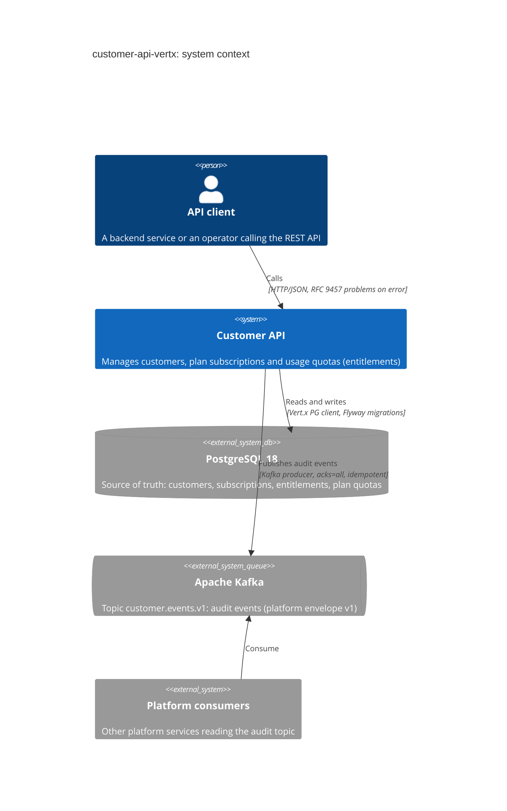

## 2. Containers (C4 level 2)

One Docker image, three kinds of process. Each process runs one verticle, and the verticles only talk to each other
through the **clustered event bus** (Vert.x on Hazelcast). `customer` is horizontally scalable: the event bus
round-robins requests across its instances.

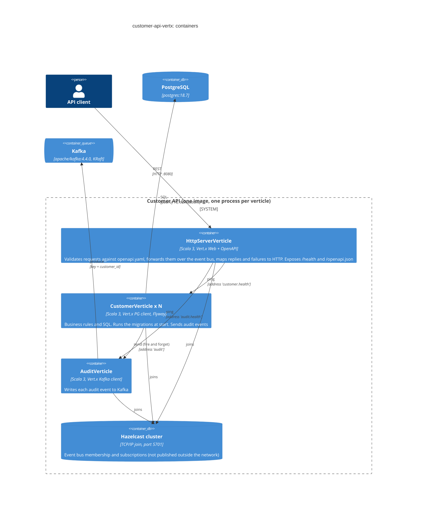

The same view as a plain flowchart, with the compose services as they run (`compose.yaml`):

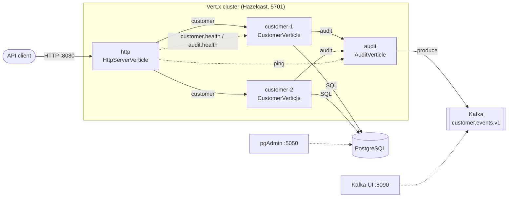

| Process    | Entry class          | Scales          | Depends on          | Config (env)                                                                  |
|------------|----------------------|-----------------|---------------------|-------------------------------------------------------------------------------|
| `http`     | `HttpServerVerticle` | yes (stateless) | the event bus       | `HTTP_PORT` (8080)                                                            |
| `customer` | `CustomerVerticle`   | yes, any number | Postgres, event bus | `PG_HOST`, `PG_PORT`, `PG_DATABASE`, `PG_USER`, `PG_PASSWORD`, `PG_POOL_SIZE` |
| `audit`    | `AuditVerticle`      | one is enough   | Kafka, event bus    | `KAFKA_BOOTSTRAP_SERVERS`, `AUDIT_TOPIC`                                      |

## 3. Components inside each verticle (C4 level 3)

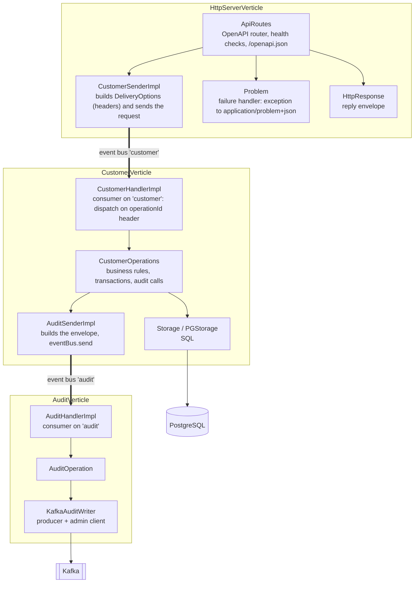

| Package    | Role                                                                                                                                                                                                   |
|------------|--------------------------------------------------------------------------------------------------------------------------------------------------------------------------------------------------------|
| `http`     | `ApiRoutes` (router built from the OpenAPI contract), `Problem` (RFC 9457 bodies), `HttpResponse` (the reply envelope that crosses the event bus), `WithHttpResponse` (turns a domain object into one) |
| `eventbus` | `*Sender` (caller side) and `*Handler` (consumer side) for `customer` and `audit`, plus `SenderUtils` (health ping/pong) and `EventbusUtils` (30 s timeout, header helpers)                            |
| `customer` | `CustomerOperations` (rules), `Storage`/`PGStorage` (SQL), `CustomerCursor` (keyset cursor codec)                                                                                                      |
| `audit`    | `AuditOperation`, `AuditLogger`, `KafkaAuditWriter`                                                                                                                                                    |
| `domain`   | Case classes, enums (`CustomerStatus`, `PlanType`, `SubscriptionStatus`) and the sealed `DomainError` family                                                                                           |
| `config`   | `*Config.fromEnv()`: one config class per verticle                                                                                                                                                     |
| `json`     | `JsonSupport`: Jackson codec for the domain objects                                                                                                                                                    |

The seams (`CustomerOps`, `Storage`, `AuditSender`, `AuditOps`, `AuditLogger`) are traits, so every layer is unit-tested
with mocks.

## 4. Event bus contract

| Address           | Pattern                     | Sender               | Consumer              | Body                                | Headers                                                         |
|-------------------|-----------------------------|----------------------|-----------------------|-------------------------------------|-----------------------------------------------------------------|
| `customer`        | request/reply, 30 s timeout | `CustomerSenderImpl` | `CustomerHandlerImpl` | request JSON as a String (or none)  | `operationId`, `id` (path), `limit`, `cursor`, `status` (query) |
| `audit`           | `send`, no reply            | `AuditSenderImpl`    | `AuditHandlerImpl`    | the event envelope as a JSON String | none                                                            |
| `customer.health` | request/reply, 4 s timeout  | `/health/ready`      | `CustomerHandlerImpl` | `"ping"`                            | none                                                            |
| `audit.health`    | request/reply, 4 s timeout  | `/health/ready`      | `AuditHandlerImpl`    | `"ping"`                            | none                                                            |

**Reply of `customer`**: a JSON String of an `HttpResponse`: `{ "statusCode", "contentType", "body", "headers" }`. The
HTTP verticle does not interpret business results: it copies the status, headers and body (adding `trace_id` to problem
bodies). A business failure (404, 409, 429...) is therefore a *successful* event bus reply carrying a problem. Only
infrastructure failures are `ReplyException`s (see [Error handling](#7-error-handling)).

**Audit envelope v1** (record key = `customer_id`):

```json
{
  "event_id": "uuid",
  "event_type": "CUSTOMER_CREATED | CUSTOMER_UPDATED | SUBSCRIPTION_CHANGED | QUOTA_EXCEEDED",
  "occurred_at": "2026-11-20T10:15:30Z",
  "producer": "customer-api",
  "schema_version": 1,
  "customer_id": "uuid",
  "...extras": "plan_type, previous_plan_type, company_name, old_status, new_status, feature_key"
}
```

## 5. Sequence diagrams

### 5.1 An HTTP request, in general

Every API call follows this path. `CustomerSenderImpl` turns the HTTP request into headers plus a JSON body,
`CustomerHandlerImpl` turns it back into a typed call.

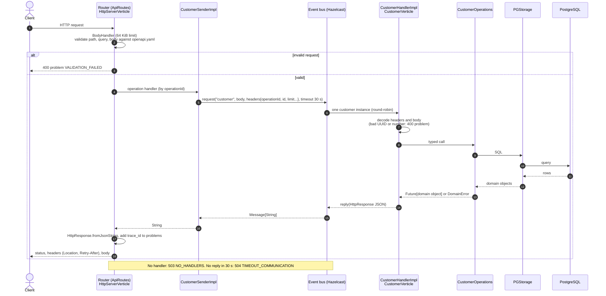

### 5.2 Create a customer (`POST /customers`)

A single statement, so no explicit transaction. The audit event is sent after the insert succeeded.

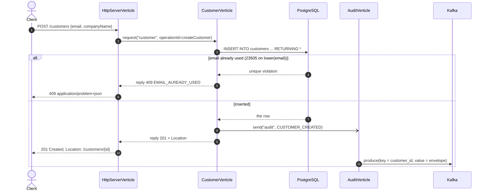

### 5.3 Subscribe to a plan (`POST /customers/{id}/subscriptions`)

One transaction. The `SELECT ... FOR UPDATE` on the customer row serializes every operation on a customer, whichever
node runs it.

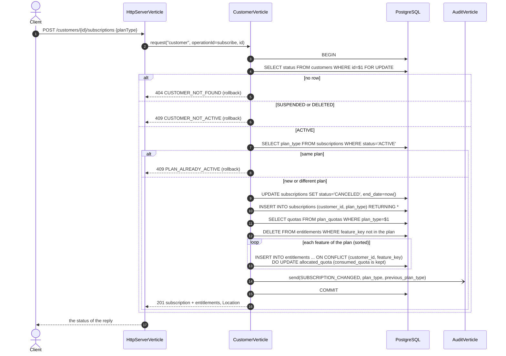

### 5.4 Consume a quota (`POST /customers/{id}/entitlements/consume`)

The hot path is one guarded `UPDATE`. The follow-up queries only run on a miss, to explain it.

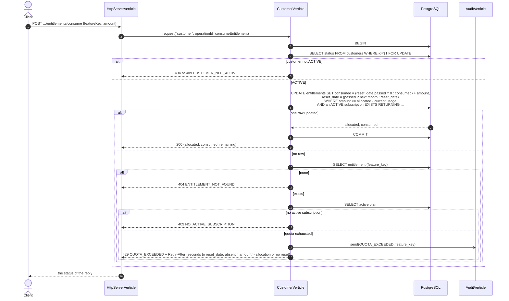

### 5.5 Update or delete a customer (`PATCH /customers/{id}`)

Deleting is a `PATCH` with `status = DELETED`: a soft delete that also cancels the active subscription. The entitlements
stay, so deleting then reactivating cannot be used to reset a quota.

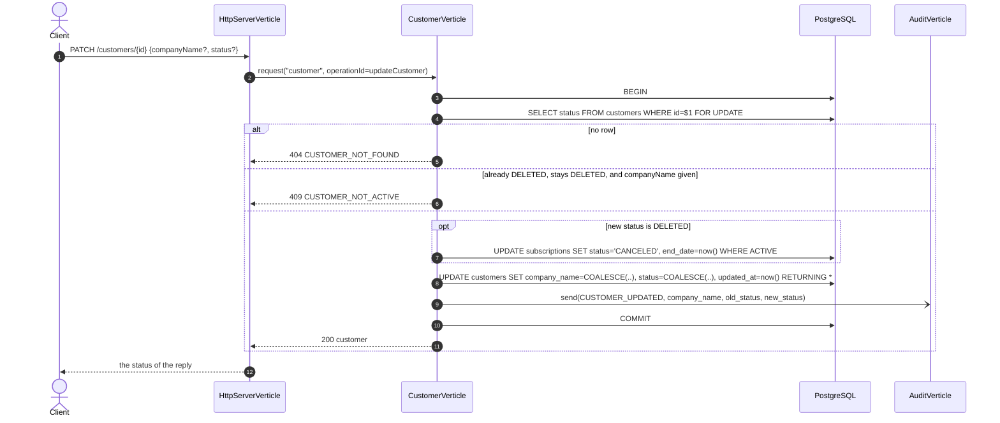

### 5.6 List customers (`GET /customers`)

Keyset pagination, newest first. The cursor is opaque: `base64url("<created_at>|<id>")` of the last item of the previous
page.

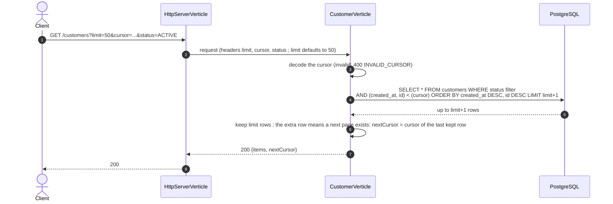

Without a `status` filter the query excludes `DELETED` customers.

### 5.7 Audit delivery

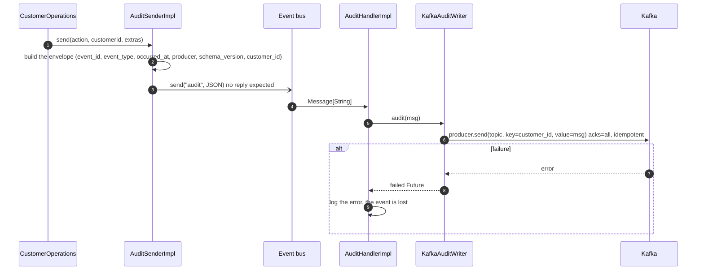

Records of one customer share a key, hence a partition, so their order is kept.

### 5.8 Readiness (`GET /health/ready`)

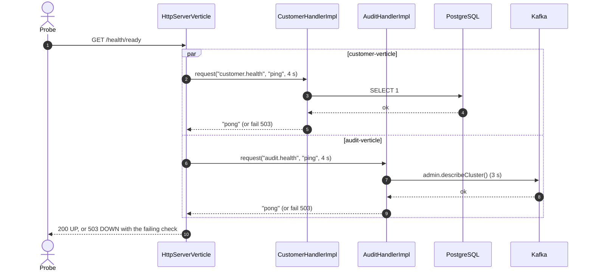

`GET /health/live` only checks that the HTTP event loop answers.

## 6. Database

PostgreSQL 18, schema managed by Flyway (`src/main/resources/db/migration`). The `customer` verticle runs the migrations
when it starts, before it registers on the event bus, so a node serves requests only once the schema is current.

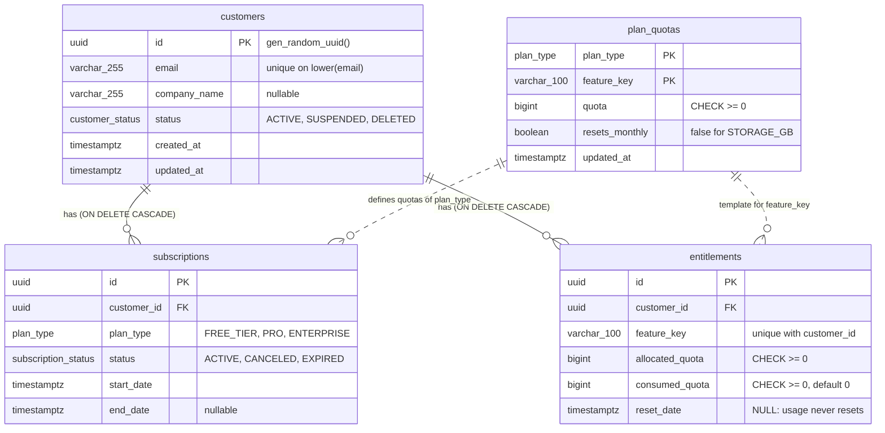

`plan_quotas` is related to the other tables by value (`plan_type`, `feature_key`), not by foreign key: it is the
catalogue the entitlements are copied from when a customer subscribes (dotted lines).

### Constraints and indexes

| Object                        | Definition                                      | Why                                                                                           |
|-------------------------------|-------------------------------------------------|-----------------------------------------------------------------------------------------------|
| `customers_email_lower_key`   | `UNIQUE (lower(email))`                         | an email is unique whatever its case, `DELETED` customers included since they can return (V5) |
| `unique_active_subscription`  | `UNIQUE (customer_id) WHERE status = 'ACTIVE'`  | one active subscription per customer; canceled and expired rows are unlimited (V1)            |
| `idx_subscriptions_customer`  | `(customer_id, start_date DESC)`                | subscription history of a customer                                                            |
| `unique_customer_feature`     | `UNIQUE (customer_id, feature_key)`             | one entitlement per feature; the `ON CONFLICT` target of the upsert, and the lookup index     |
| `customers_created_at_id_idx` | `(created_at DESC, id DESC)`                    | keyset pagination of `GET /customers` (V6)                                                    |
| `CHECK (... >= 0)`            | on `allocated_quota`, `consumed_quota`, `quota` | no negative usage                                                                             |
| FKs `ON DELETE CASCADE`       | `subscriptions`, `entitlements` to `customers`  | the API soft-deletes, the cascade is a safety net                                             |

### Seeded plans (`plan_quotas`)

| Plan         | `API_CALLS_MONTHLY` | `STORAGE_GB` |
|--------------|---------------------|--------------|
| `FREE_TIER`  | 1 000               | 1            |
| `PRO`        | 100 000             | 50           |
| `ENTERPRISE` | 10 000 000          | 1 000        |

`STORAGE_GB` has `resets_monthly = false`: it measures what is held, so its `reset_date` is `NULL` and its usage never
resets. `API_CALLS_MONTHLY` resets on the first day of the next month (UTC).

### Migrations

| Version | Change                                                                |
|---------|-----------------------------------------------------------------------|
| V1      | enums, `customers`, `subscriptions`, `entitlements`                   |
| V2      | `plan_quotas` and its seed                                            |
| V3      | `resets_monthly`, nullable `entitlements.reset_date`                  |
| V4      | data fix: cancel the active subscription of customers already deleted |
| V5      | case-insensitive unique email                                         |
| V6      | pagination index                                                      |

### State machines

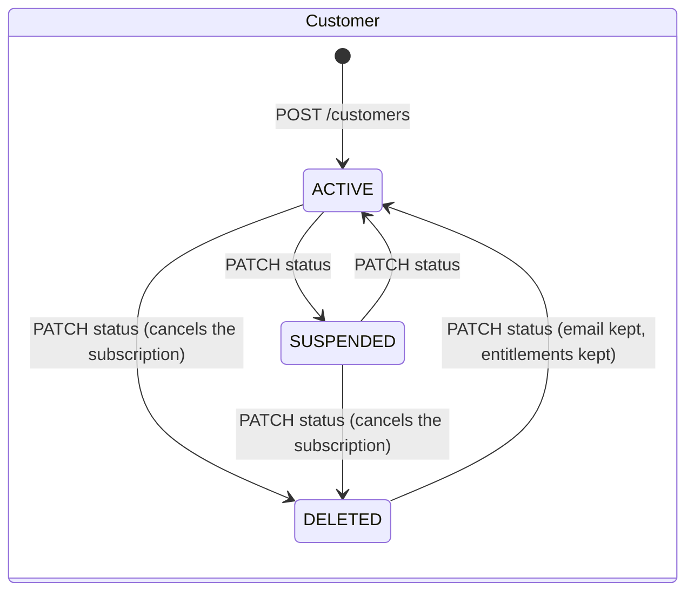

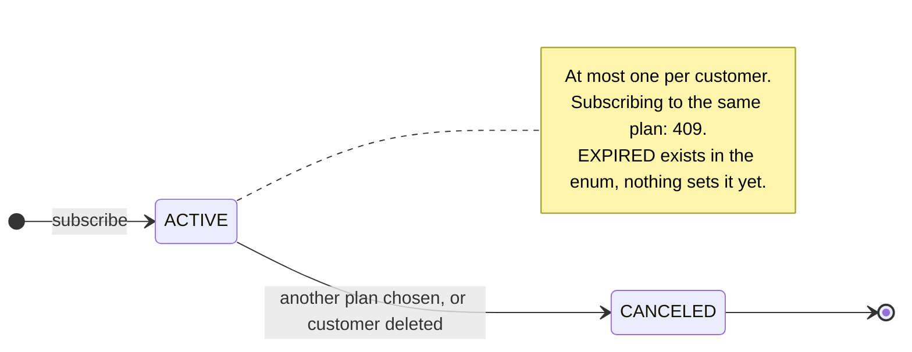

### Quota lifecycle

- **Subscribe:** the entitlements are aligned with the plan. Missing features are inserted, existing ones get the new
  `allocated_quota` and keep their `consumed_quota`, the ones outside the plan are deleted. Changing plan never frees
  quota.
- **Consume:** one conditional `UPDATE`. When `reset_date` has passed, the usage restarts from 0 and `reset_date` moves
  to the first day of the next month, in the same statement.
- **Read:** `GET /entitlements` returns the *effective* view (`Entitlement.effective(now)`): a period that already ended
  shows 0 consumed even before the next consume rewrites the row.

## 7. Error handling

Errors come from four places and all end as `application/problem+json` (`title`, `status`, `code`, `detail`, and
`trace_id` when the request carried a W3C `traceparent` header).

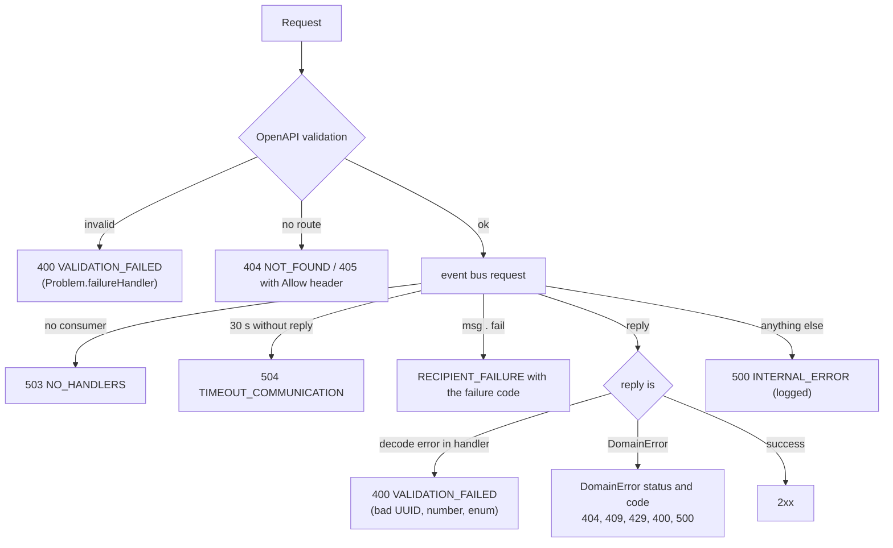

| `DomainError`          | Status                                    | Code                     |
|------------------------|-------------------------------------------|--------------------------|
| `InvalidCursor`        | 400                                       | `INVALID_CURSOR`         |
| `CustomerNotFound`     | 404                                       | `CUSTOMER_NOT_FOUND`     |
| `EntitlementNotFound`  | 404                                       | `ENTITLEMENT_NOT_FOUND`  |
| `EmailAlreadyUsed`     | 409                                       | `EMAIL_ALREADY_USED`     |
| `CustomerNotActive`    | 409                                       | `CUSTOMER_NOT_ACTIVE`    |
| `PlanAlreadyActive`    | 409                                       | `PLAN_ALREADY_ACTIVE`    |
| `NoActiveSubscription` | 409                                       | `NO_ACTIVE_SUBSCRIPTION` |
| `QuotaExceeded`        | 429 (`Retry-After` when waiting can help) | `QUOTA_EXCEEDED`         |
| `PlanNotConfigured`    | 500                                       | `PLAN_NOT_CONFIGURED`    |

## 8. Health checks

| Endpoint            | Checks                                                                                               | Status           |
|---------------------|------------------------------------------------------------------------------------------------------|------------------|
| `GET /health/live`  | the HTTP verticle answers                                                                            | 200              |
| `GET /health/ready` | `customer-verticle` (a customer node runs `SELECT 1`) and `audit-verticle` (Kafka `describeCluster`) | 200 UP, 503 DOWN |

Timeouts are nested so that each layer fails by itself before the one above gives up: Kafka admin 3 s, event bus ping 4
s, health check 5 s.

## 9. Deployment

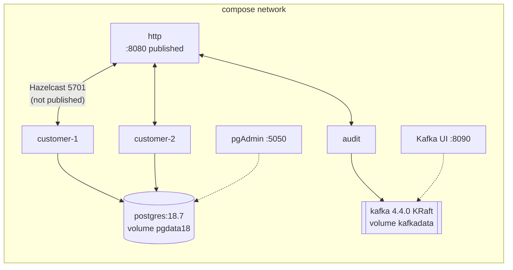

- One image (`Dockerfile`, multi-stage Maven build, JRE 25) for the three verticles. The container command picks the
  verticle.
- `docker/entrypoint.sh` starts the Vert.x application with `-c --cluster-host <container IP>` and `docker/cluster.xml`:
  Hazelcast joins by TCP/IP on the compose service names.
- `restart: unless-stopped`; Postgres and Kafka have health checks and the verticles wait for them.
- Locally, the same three processes can be started by hand (see the [README](../README.md#running-without-docker)).

## 10. Design decisions and caveats

- **Verticles as services over the event bus.** The HTTP layer has no business logic and the business layer has no HTTP.
  A customer node can be added or lost at runtime (`ClusterIT`, `cluster-topology.feature`).
- **Business results travel as data.** The customer verticle replies with a ready `HttpResponse`, so the HTTP verticle
  stays a thin translator.
- **Correctness is in Postgres, not in memory.** The customer row lock (`FOR UPDATE`) serializes the operations of one
  customer across nodes, and the consume `UPDATE` is atomic and guarded, so a quota is exact with several writers.
- **Audit is fire-and-forget.** There is no outbox: if the audit verticle or Kafka is down, events are logged and lost.
  Consequently:
    - in `subscribe`, `update` and the `QUOTA_EXCEEDED` path, the event is sent *before* the transaction commits, so a
      failed commit can leave an event for a change that did not happen;
    - a successful consume emits no event (high volume).
- **Timeouts do not cancel work.** After the 30 s the client gets a 504 but the transaction can still commit. Consume
  has no idempotency key, so a retry after a 504 can consume twice. Check `GET /entitlements` first.
- **No authentication** on the HTTP API or on the Hazelcast cluster. Run it on a trusted network only.

See the [README](../README.md) for setup, tests and the full list of known limitations.
